# Trustworthy E-commerce Lakehouse
### End-to-end Databricks Medallion Pipeline: Bronze → Silver → Gold → AI/BI · Genie · Power BI


An e-commerce company receives daily CSV extracts of **orders** and **payment transactions**. The data is messy: blank values, text in numeric fields, negative amounts, impossible dates, inconsistent labels, orphan payments and duplicate keys. Reports built on it disagree with each other.

This project builds a governed lakehouse on Databricks that **keeps the raw evidence, cleans with explicit rules, accounts for every single row, and publishes one reproducible revenue number** that matches across Databricks SQL, an AI/BI dashboard, a Genie agent and Power BI.

---

## Table of contents
1. [Highlights](#1-highlights)
2. [Architecture](#2-architecture)
3. [Tech stack & repository layout](#3-tech-stack--repository-layout)
4. [Step 1: Workspace & governance setup](#4-step-1--workspace--governance-setup)
5. [Step 2: Synthetic dirty data](#5-step-2--synthetic-dirty-data)
6. [Step 3: Bronze, lossless ingestion](#6-step-3--bronze-lossless-ingestion)
7. [Step 4: Silver, validation, deduplication & reconciliation](#7-step-4--silver-validation-deduplication--reconciliation)
8. [Step 5: Gold, business-ready marts](#8-step-5--gold-business-ready-marts)
9. [Step 6: Automated quality gate](#9-step-6--automated-quality-gate)
10. [Step 7: Databricks AI/BI dashboard](#10-step-7--databricks-aibi-dashboard)
11. [Step 8: Genie agent, verified against SQL](#11-step-8--genie-agent-verified-against-sql)
12. [Step 9: Power BI Desktop](#12-step-9--power-bi-desktop)
13. [Step 10: Cross-tool revenue reconciliation](#13-step-10--cross-tool-revenue-reconciliation)
14. [Step 11: Orchestration with Lakeflow Jobs](#14-step-11--orchestration-with-lakeflow-jobs)
15. [Security, governance & cost control](#15-security-governance--cost-control)
16. [How to reproduce](#16-how-to-reproduce)
17. [Design decisions & lessons learned](#17-design-decisions--lessons-learned)

---

## 1. Highlights

| Metric | Result |
|---|---|
| Source rows ingested | **2,000,000** (1,000,000 orders + 1,000,000 transactions) |
| Source → Bronze parity | **100%**, both datasets PASS |
| Rows accounted for in Silver | **100%**: every raw row lands in exactly one outcome bucket |
| Business rules enforced | Full rule matrix (13 distinct rules triggered) + deterministic deduplication |
| Gold marts | 4, each with a documented grain and unique key |
| Automated acceptance checks | **18 / 18 PASS**, wired as a hard gate in the job |
| Total revenue (2026, USD) | **$10,482,656.92** from **23,189** eligible orders |
| Orchestrated run | Bronze → Silver → Gold → Checks, **Succeeded in 3 min** on serverless |

---

## 2. Architecture

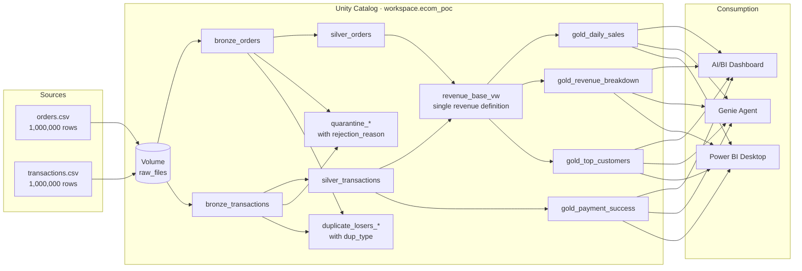

| Layer | Contract |
|---|---|
| **Raw volume** | Source files stored unchanged at `/Volumes/workspace/ecom_poc/raw_files/` |
| **Bronze** | Every source field as `STRING`, plus audit columns. Row count = source row count. |
| **Silver** | Typed, validated, unique keys. Rejected rows → quarantine. Non-winning duplicates → duplicate losers. `bronze = accepted + quarantined + duplicate losers`. |
| **Gold** | Business marts derived from one revenue definition (`revenue_base_vw`), each with documented grain. |

---

## 3. Tech stack & repository layout

**Platform:** Databricks free trial (express setup), Unity Catalog, Delta Lake, serverless notebook & job compute, Serverless Starter SQL Warehouse, AI/BI Dashboards, Genie, Lakeflow Jobs, Databricks CLI · **Languages:** Spark SQL, Python · **BI:** Power BI Desktop (native Databricks connector, Import mode)

```
├── generator/generate_data.py          Seeded synthetic data generator (1M rows per file)
├── notebooks/
│   ├── 01_setup.sql                    Schema, volume, independent source inventory
│   ├── 02_bronze_ingestion.sql         Lossless, idempotent STRING ingestion + audit columns
│   ├── 03_silver_quality.sql           Safe typing, rule matrix, quarantine, dedup, reconciliation
│   ├── 04_gold_models.sql              Revenue definition + 4 documented Gold marts
│   └── 05_quality_checks.sql           18 acceptance checks; fails the job on any FAIL
├── sql/
│   ├── 01_rules_matrix.sql             Business-rule matrix
│   ├── 02_grants_least_privilege.sql   Gold-only reporting grants
│   ├── 03_cross_tool_validation.sql    Same-filter revenue check + mismatch checklist
│   ├── 04_dashboard_datasets.sql       AI/BI dashboard datasets
│   └── 05_genie_verification.sql       Trusted SQL behind each Genie question
├── dashboards/                         Dashboard spec, Genie question checks
├── powerbi/                            ecom_lakehouse.pbix, DAX measures, Power Query import
├── operations/                         Lakeflow job definition, permissions test plan, cleanup checklist
├── pipeline/                           Exported Lakeflow job JSON
└── evidence/                           Screenshots from the live workspace and the dirty-data report
```

---

## 4. Step 1: Workspace & governance setup

A personal **Databricks free trial** workspace was created with express setup, which provides a managed serverless workspace. The free *trial* is a full-feature workspace with a time-limited credit allowance (serverless, SQL warehouses, Lakeflow Jobs, AI/BI, Genie, Unity Catalog administration). *Free Edition* is a permanently free but quota-restricted environment, and the legacy *Community Edition* has no Unity Catalog.

```sql
USE CATALOG workspace;
CREATE SCHEMA IF NOT EXISTS ecom_poc;
CREATE VOLUME IF NOT EXISTS raw_files;
```

**Naming standard:** `bronze_*` raw · `silver_*` trusted · `quarantine_*` rejected rows · `duplicate_losers_*` non-winners · `gold_*` marts · `*_vw` views · `_col` audit columns.

**Compute strategy:**
- **ETL:** serverless notebook and job compute. It starts in seconds and leaves no idle cluster behind.
- **BI:** one small Serverless Starter SQL Warehouse with auto-stop.
- **Credit discipline:** single end-to-end runs, no parallel experiments, no schedules.

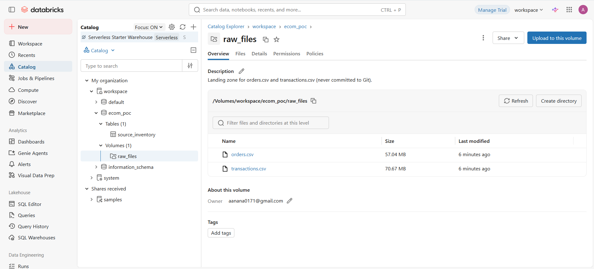
*Catalog Explorer: catalog `workspace` › schema `ecom_poc` › managed volume `raw_files`, holding `orders.csv` (57.04 MB) and `transactions.csv` (70.67 MB). The `source_inventory` table records an independent count of each file.*

---

## 5. Step 2: Synthetic dirty data

`generator/generate_data.py` produces **exactly 1,000,000 data rows per file** from a fixed seed (`--seed 20261117`), so every run is byte-identical. It verifies this with a SHA-256 per file. No real customer data is involved.

| File | Columns | Rows | Bytes |
|---|---|---|---|
| `orders.csv` | order_id, customer_id, order_date, category, quantity, unit_price, order_status, country | 1,000,000 | 59,807,067 |
| `transactions.csv` | txn_id, order_id, payment_method, amount, currency, txn_status, txn_ts | 1,000,000 | 74,098,098 |

**Injected anomalies** (full inventory in [`evidence/dirty_data_report.json`](evidence/dirty_data_report.json)):

| Anomaly | Orders | Transactions |
|---|---:|---:|
| Null / blank values | 4,977 (0.50%) | 4,739 (0.47%) |
| Text inside numeric field | 3,003 (0.30%) | 3,257 (0.33%) |
| Negative / out-of-range number | 2,493 (0.25%) | 2,386 (0.24%) |
| Future date / timestamp | 1,988 (0.20%) | 1,919 (0.19%) |
| Unparseable date / timestamp | 1,233 (0.12%) | 1,236 (0.12%) |
| Inconsistent case / whitespace labels | 1,647 (0.16%) | 1,631 (0.16%) |
| Invalid country | 1,426 (0.14%) | — |
| Orphan order id (injected + natural) | — | 1,390 + 47,894 |
| Duplicate key, conflicting content | 5 | 5 |
| Exact duplicate row | 24 | 22 |

**Why the anomalies stay a small, measured fraction:** if most rows were bad, no rule could separate good data from bad, quarantine would swallow the dataset, and analytics would be meaningless. A small, *known* fraction exercises every rule while leaving a trustworthy majority. Because the counts are seeded and recorded, the pipeline's catch rate can be proven against the report.

**Why raw data and credentials never go into Git:** Git history is permanent and widely copied, so leaked secrets or personal data cannot be recalled, and million-row extracts bloat the repository. Raw data belongs in governed storage. In production, the minimum controls are:
- a secret manager instead of secrets in code
- least-privilege Unity Catalog grants
- encryption at rest and in transit
- PII masking or tokenisation
- audit logging
- pre-commit secret scanning
- retention policies and periodic access reviews

---

## 6. Step 3: Bronze, lossless ingestion

Each CSV is loaded into its own Delta table with **every column as `STRING`** (`inferSchema => false`). Malformed values are preserved exactly as received. Bronze is the immutable record of what the source sent. Rejecting rows at this stage would hide problems, break row-count parity and make reprocessing impossible when rules change.

| Audit column | Purpose |
|---|---|
| `_ingested_at` | When the row was loaded |
| `_source_file` | Which file in the volume it came from |
| `_batch_id` | Which load it belongs to; also the idempotency key |
| `_row_id` | Unique id of the raw row, carried into every downstream outcome table |
| `_row_hash` | SHA-256 of the row content; detects exact duplicates and changes |

**Idempotency:** inserts are guarded with `WHERE NOT EXISTS (batch already loaded)`, so re-running the same batch adds zero rows.

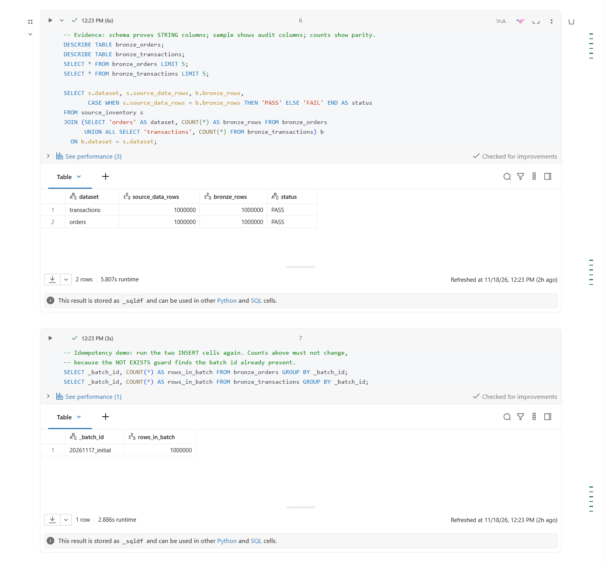
*Source-to-Bronze parity: `source_inventory` counts the files independently as plain text, and Bronze matches it exactly, with **1,000,000 = 1,000,000 PASS** for both datasets. Below it, re-running the INSERT cells leaves a single batch (`20261117_initial`) with 1,000,000 rows, which proves the load is idempotent.*

---

## 7. Step 4: Silver, validation, deduplication & reconciliation

**Processing order:** validate → quarantine invalid rows → deduplicate *only among valid rows*. Because each step sees only what the previous one passed, every raw row receives exactly one outcome.

- **Safe typing:** `try_cast` converts text to numbers, dates and timestamps. A value that cannot be parsed becomes `NULL` and is then flagged by an `invalid_*_type` rule. The row is quarantined; the job never crashes and no row is silently dropped.
- **Rule matrix** ([`sql/01_rules_matrix.sql`](sql/01_rules_matrix.sql)): mandatory fields, valid numeric ranges, allowed statuses, categories, countries and payment methods, supported currencies, no future dates or timestamps, orphan-order and rejected-parent relationship checks. Labels are trimmed and lower-cased before validation.
- **Quarantine:** rejected rows keep all original columns and audit ids, plus a `rejection_reason`. A row that fails several rules lists all of them.
- **Deterministic deduplication:** the business key is `order_id` or `txn_id`. The kept row is the one with the smallest `_row_hash`, then `_row_id`, so the result is identical on every re-run. Non-winners go to `duplicate_losers_*`, tagged with a `dup_type` of either `exact_duplicate_row` (same key, same content) or `conflicting_key_duplicate` (same key, different content).

### Reconciliation: every raw row accounted for

| Dataset | Bronze | Accepted (Silver) | Quarantined | Duplicate losers | Equation |
|---|---:|---:|---:|---:|:---:|
| orders | 1,000,000 | 868,986 | 130,995 | 19 | ✅ PASS |
| transactions | 1,000,000 | 718,323 | 281,655 | 22 | ✅ PASS |

A `silver_row_outcomes` view lists each `(dataset, _row_id, outcome)`. The quality gate proves that no `_row_id` appears twice and none is missing.

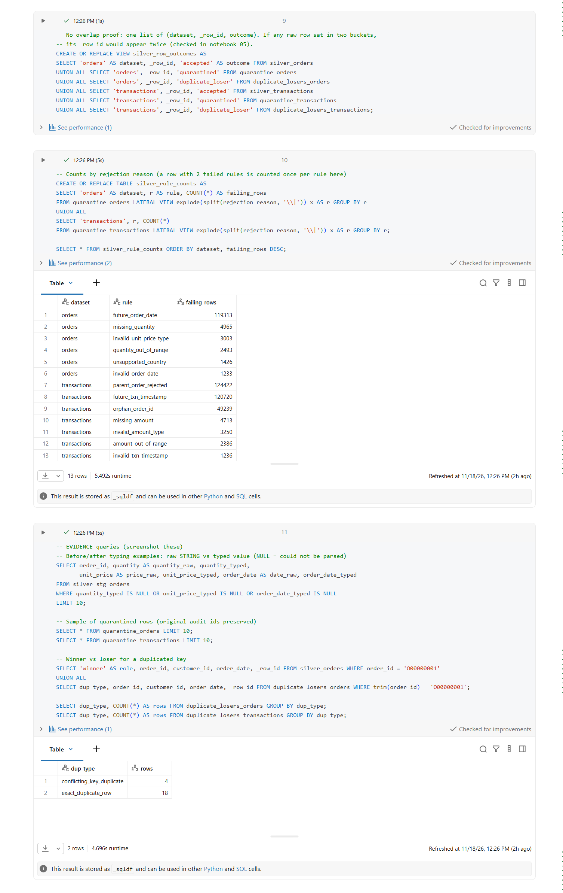
*Silver evidence:*
- *The `silver_row_outcomes` view, used to prove there is no overlap between buckets.*
- *Failing-row counts per rule. The largest is `future_order_date`, followed by `parent_order_rejected`: a payment is rejected when its order was quarantined.*
- *The split of duplicate losers into `exact_duplicate_row` and `conflicting_key_duplicate`.*

> **Note on the `future_*` rules:** they compare against `current_date()` and `current_timestamp()`. The generator spreads dates across all of 2026, so orders dated after the run day are quarantined as "future". Each later run therefore accepts slightly more history. This is intended behaviour, and it explains the small revenue difference between runs on different days (see [Step 10](#13-step-10--cross-tool-revenue-reconciliation)).

---

## 8. Step 5: Gold, business-ready marts

### Revenue definition (single source of truth: `revenue_base_vw`)
> **Revenue** is the sum of **one accepted payment per eligible order**.
> - **Eligible order:** `order_status` is `completed` or `delivered`.
> - **Accepted payment:** `txn_status = 'success'` and `currency = 'USD'`. If an order has several, the earliest `txn_ts` (then `txn_id`) wins.
> - **Excluded:** cancelled, pending or returned orders; failed, pending or refunded payments; non-USD payments (no FX conversion is applied); repeat or partial extra payments; duplicates, orphans and quarantined rows.

**Worked example:**
- Order **O1** is completed and has three payments: T1 USD 100 success, T2 USD 100 success (a repeat), T3 EUR 90 success. Revenue is **100** (T1 only).
- Order **O2** is cancelled but has a successful payment. Revenue is **0**.

A naive join of orders to all payments would report 200 or more.

### Marts

| Table | Grain / unique key | Rows | Purpose |
|---|---|---:|---|
| `gold_daily_sales` | `order_date` | 322 | Daily revenue, revenue orders, cancellation rate |
| `gold_revenue_breakdown` | `(category, country)` | 42 | Revenue by category and country |
| `gold_payment_success` | `payment_method` | 4 | Attempts, successes, failures, success rate |
| `gold_top_customers` | `customer_id` | 22,119 | Spend and rank per customer |

All marts are derived from `revenue_base_vw`, which has one row per order, so many-to-one joins can never multiply payment values. Every table carries table- and column-level `COMMENT`s plus `TBLPROPERTIES (grain, unique_key)`. This documentation prevents misreadings: a column simply named `revenue` invites someone to sum EUR, include cancelled orders or average a ratio. The comment states the grain, filters and non-additivity next to the data itself.

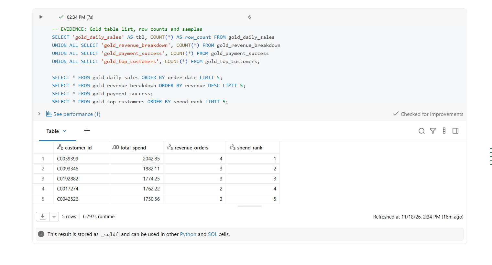
*Gold evidence: the row-count and sample queries for all four marts. The visible result is `gold_top_customers` ranked by spend.*

---

## 9. Step 6: Automated quality gate

`notebooks/05_quality_checks.sql` writes **18 acceptance checks** to `quality_check_results` and ends with `assert_true(...)`. The task, and therefore the job, **fails if any check is not PASS**.

| Group | Checks |
|---|---|
| Ingestion | Source = Bronze for each dataset · exactly 1,000,000 rows per file |
| Reconciliation | Outcome equation per dataset · no overlap and no gap in `_row_id` |
| Integrity | Unique business keys in Silver · no orphan transactions in Silver |
| Gold | Unique grain keys in all marts |
| Revenue | Daily = breakdown = top customers = an independently written query |
| Sanity | Cancellation rate is genuinely measured (not all zero) |

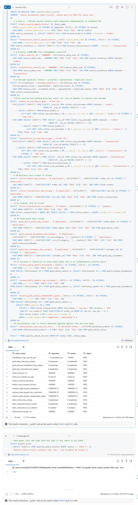
*Quality gate: every check returns PASS, including three independent revenue cross-checks. The final `assert_true` cell returns `null`, meaning no FAIL rows were found.*

---

## 10. Step 7: Databricks AI/BI dashboard

The dashboard is built on Gold datasets ([`sql/04_dashboard_datasets.sql`](sql/04_dashboard_datasets.sql)) and has:
- four KPI counters: Total Revenue, Revenue Orders, Average Order Value, Cancellation Rate
- a daily revenue trend
- revenue by category and by country
- a shared date filter bound to `order_date` on every dataset

Ratios are always computed as a sum divided by a sum, never as an average of ratios.

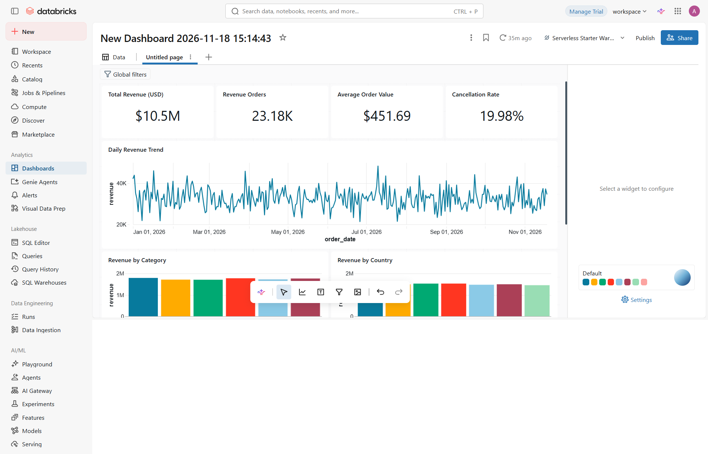
*AI/BI dashboard: $10.5M total revenue, 23.18K revenue orders, 19.98% cancellation rate, a full-year daily trend, and category and country breakdowns, all served from the Serverless Starter Warehouse.*

---

## 11. Step 8: Genie agent, verified against SQL

A Genie agent was created over the Gold tables and asked three business questions. Each answer was cross-checked against trusted SQL ([`sql/05_genie_verification.sql`](sql/05_genie_verification.sql), [`dashboards/genie_checks.md`](dashboards/genie_checks.md)).

| # | Question | Genie answer | Trusted SQL | Match |
|---|---|---|---|:---:|
| 1 | What was total revenue in 2026 and how many orders produced it? | $10,480,045.10 · 23,183 orders | $10,480,045.10 · 23,183 | ✅ |
| 2 | Which category and country combination earned the most revenue? | Beauty / AU, $294,499.38 (632 orders) | Beauty / AU, $294,499.38 | ✅ |
| 3 | Which payment method has the highest success rate? | Bank transfer, 25.25% (45,149 / 178,793) | Bank transfer, 25.25% | ✅ |

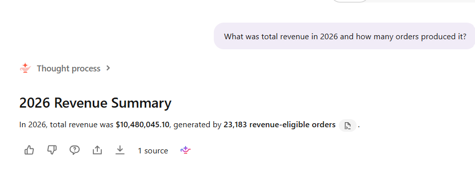
*Q1: Genie reports $10,480,045.10 from 23,183 revenue-eligible orders, the same value as the Gold revenue check from the same pipeline run.*

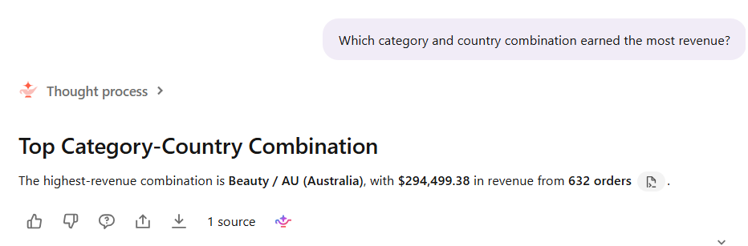
*Q2: Beauty / Australia is the top combination at $294,499.38, matching the top row of `gold_revenue_breakdown`.*

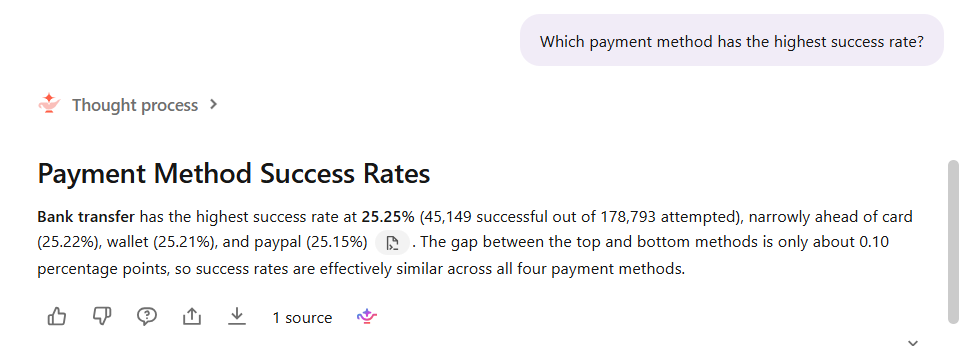
*Q3: Bank transfer leads at 25.25%. Genie also notes that the four methods are within about 0.10 percentage points of each other, which is consistent with `gold_payment_success`.*

---

## 12. Step 9: Power BI Desktop

Power BI Desktop connects to the SQL warehouse through the **native Databricks connector** in **Import** mode ([`powerbi/gold_import.pq`](powerbi/gold_import.pq)) and loads only the Gold tables plus `revenue_base_vw`.

| | Import (chosen) | DirectQuery |
|---|---|---|
| Speed | Fast, in-memory | Every click becomes a warehouse query |
| Freshness | As of the last refresh | Always live |
| Cost | The warehouse can stop after refresh | The warehouse must stay running (credits) |
| DAX | Full support | Some restrictions |

With roughly 300 daily rows and small marts, Import is the right trade-off.

**Measures** ([`powerbi/measures.dax`](powerbi/measures.dax)) use exactly the same definitions as the Databricks dashboard:

```DAX
Total Revenue        = SUM ( gold_daily_sales[revenue] )
Revenue Orders       = SUM ( gold_daily_sales[revenue_orders] )
Average Order Value  = DIVIDE ( [Total Revenue], [Revenue Orders] )
Cancellation Rate    = DIVIDE ( SUM ( gold_daily_sales[cancelled_orders] ), SUM ( gold_daily_sales[total_orders] ) )
Payment Success Rate = DIVIDE ( SUM ( gold_payment_success[successful_transactions] ),
                                SUM ( gold_payment_success[attempted_transactions] ) )
```

The model relates `revenue_base_vw[order_date]` (many) to `gold_daily_sales[order_date]` (one), so the category chart also follows the date slicer.

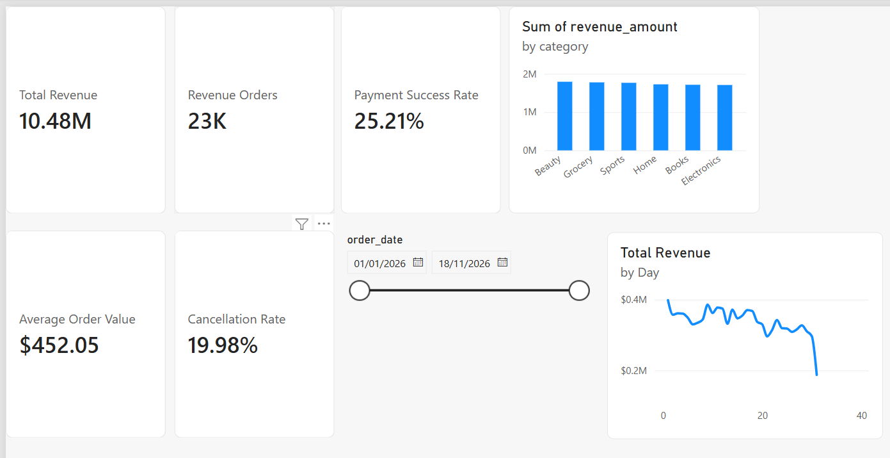
*Power BI report ([`powerbi/ecom_lakehouse.pbix`](powerbi/ecom_lakehouse.pbix)):*
- *Five KPI cards: Total Revenue 10.48M, Revenue Orders 23K, Average Order Value $452.05, Cancellation Rate 19.98%, Payment Success Rate 25.21%.*
- *Revenue by category, a revenue trend, and an `order_date` range slicer covering the full data range (01/01/2026–18/11/2026).*

---

## 13. Step 10: Cross-tool revenue reconciliation

All tools use the same definition, the same Gold source, USD only, and order dates from 2026-01-01 to 2026-12-31.

| Pipeline run | Tool | Total revenue | Revenue orders | AOV |
|---|---|---:|---:|---:|
| Run A (18 Nov) | Quality gate (independent SQL) | $10,480,045.10 | — | — |
| Run A (18 Nov) | Genie agent | $10,480,045.10 | 23,183 | — |
| Run A (18 Nov) | AI/BI dashboard | $10.5M | 23.18K | — |
| **Current** | **Databricks SQL** (`gold_daily_sales`) | **$10,482,656.92** | **23,189** | $452.05 |
| **Current** | Databricks SQL (`revenue_base_vw`, independent) | $10,482,656.92 | 23,189 | $452.05 |
| **Current** | Quality gate (3 revenue checks) | $10,482,656.92 | — | — |
| **Current** | **Power BI** | 10.48M | 23K | **$452.05** |

**Within a run, every tool agrees.** In Power BI, $452.05 is exactly $10,482,656.92 ÷ 23,189, so its unrounded totals match the SQL values.

**Between runs**, revenue rose by $2,611.82 and orders by 6. This is expected: the Silver `future_*` rules compare against `current_date()`, so a later run accepts orders whose dates were still in the future on the earlier run (see the note in [Step 4](#7-step-4--silver-validation-deduplication--reconciliation)).

[`sql/03_cross_tool_validation.sql`](sql/03_cross_tool_validation.sql) contains the same-filter query and a checklist for diagnosing mismatches. The checklist covers rounding, date-filter bounds, currency, stale Import refreshes, and measures built on the wrong table.

---

## 14. Step 11: Orchestration with Lakeflow Jobs

The job `ecom_medallion_pipeline` chains the four notebooks on serverless compute. The definition is in [`operations/lakeflow_job.yml`](operations/lakeflow_job.yml) and the exported job JSON in [`pipeline/`](pipeline/).

| Task | Depends on | Retries |
|---|---|---|
| `bronze_ingestion` | — | 2 |
| `silver_quality` | bronze_ingestion | 1 |
| `gold_models` | silver_quality | 1 |
| `quality_checks` | gold_models | 1 |

Each retry waits 60 seconds, which absorbs transient serverless or startup errors. A genuine data failure still fails the run once its retries are used up.

**Notifications:** an email is sent when a run starts, succeeds or fails. Alerts for skipped and cancelled runs are suppressed to avoid noise.

**Schedule:** none. The job is run manually and queued if a run is already in progress.

**Why Gold does not run after a failed dependency:** if `silver_quality` fails, `gold_models` is marked *Upstream failed* and skipped. Otherwise Gold would publish numbers built from stale or half-written Silver data. A missing report is safer than a wrong one.

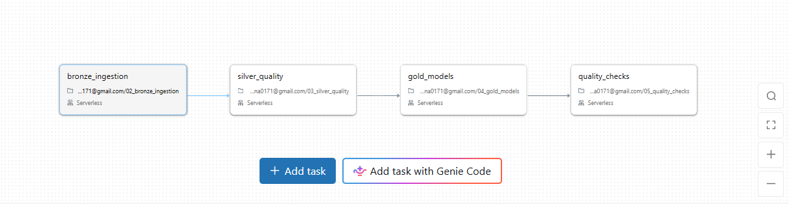
*Job graph: `bronze_ingestion → silver_quality → gold_models → quality_checks`, each task on serverless compute.*

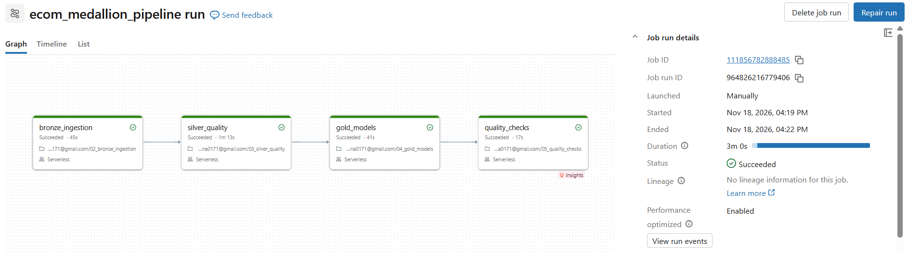
*Successful run: all four tasks succeeded (Bronze 45 s, Silver 1 m 13 s, Gold 41 s, Checks 17 s), for a total duration of 3 min. The run was launched manually.*

---

## 15. Security, governance & cost control

- **Least privilege:** reporting users receive `USE CATALOG`, `USE SCHEMA` and `SELECT` on Gold tables only, with no access to Bronze, Silver, quarantine or the raw volume ([`sql/02_grants_least_privilege.sql`](sql/02_grants_least_privilege.sql)). The test procedure, covering both allowed and denied queries, is in [`operations/permissions_test_plan.md`](operations/permissions_test_plan.md).
- **Secrets hygiene:** no tokens or credentials are stored in the repository or the `.pbix`. Power BI authenticates interactively, and personal access tokens are revoked after use.
- **Lineage:** `_row_id` and `_source_file` let any Gold figure be traced back to the exact raw rows and source file.
- **Cost control:**
  - serverless compute for ETL
  - a small auto-stopping SQL warehouse
  - Power BI in Import mode, so the warehouse can stop after refresh
  - no job schedules, and no payment method or upgrade on the trial

  The end-of-trial procedure is in [`operations/cleanup_checklist.md`](operations/cleanup_checklist.md).

---

## 16. How to reproduce

```bash
# 1. Generate the data (identical output for the same seed)
python generator/generate_data.py --output-dir ./generated --seed 20261117
```

2. In Databricks, run `notebooks/01_setup.sql`, then upload both CSVs to `/Volumes/<catalog>/ecom_poc/raw_files/`. Use `tools/set_catalog.py` if your catalog is not named `workspace`.
3. Run notebooks `02` → `05`, or import [`operations/lakeflow_job.yml`](operations/lakeflow_job.yml) and run the job once.
4. Create the AI/BI dashboard from [`sql/04_dashboard_datasets.sql`](sql/04_dashboard_datasets.sql) and the Genie agent over the `gold_*` tables.
5. Open [`powerbi/ecom_lakehouse.pbix`](powerbi/ecom_lakehouse.pbix) and point it at your SQL warehouse, or follow [`powerbi/powerbi_instructions.md`](powerbi/powerbi_instructions.md).
6. Validate the results with [`sql/03_cross_tool_validation.sql`](sql/03_cross_tool_validation.sql).

---

## 17. Design decisions & lessons learned

- **Keep everything, decide later.** Bronze stores strings exactly as received, which makes every rule change replayable without re-requesting source data.
- **Count, don't hope.** The equation `bronze = accepted + quarantined + duplicate losers`, together with the `_row_id` overlap check, turns "the data looks clean" into a provable statement.
- **One revenue definition, many tools.** Defining revenue once in `revenue_base_vw` and deriving every mart, dashboard, Genie answer and DAX measure from it is what makes four tools agree to the cent.
- **Validate before deduplicating.** Deduplicating first could keep an invalid row as the winner and discard its valid twin.
- **Determinism everywhere.** A seeded generator, hash-based tie-breaking and an ordered choice of payment winner mean identical inputs always produce identical outputs.
- **Time-relative rules make results depend on the run date.** The `future_*` checks move with `current_date()`, so revenue shifts slightly between runs on different days. In production, these rules would be anchored to the batch's ingestion timestamp to make reruns fully reproducible.

---

*All data in this project is synthetic. No real customer information, credentials or tokens are included.*
